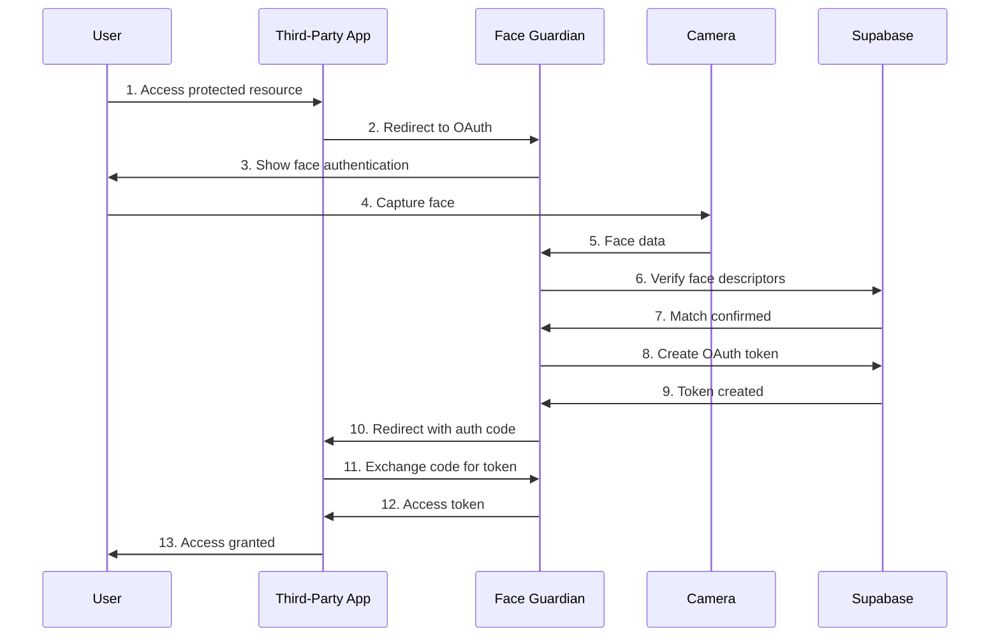
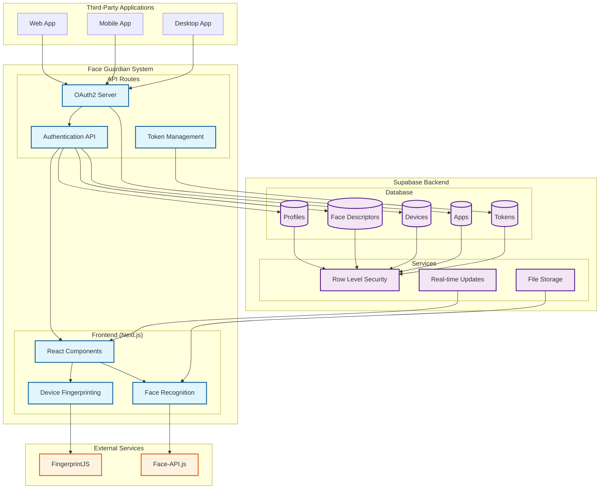

# Face Guardian

Passwordless authentication for the web. A user signs in by looking at their camera, and third-party apps consume that login through a standard OAuth2 flow.

I built this to see whether face recognition could be made into something a developer could actually drop into an app, rather than a demo that only works on the author's laptop. The face matching runs in the browser with Face-API.js, so raw images never reach the server. Only the numeric descriptors are stored, encrypted.

Built with Next.js 14, TypeScript, and Supabase.

## How it works

A user registers once by capturing their face. After that, any app that integrates Face Guardian can redirect to it, get the user authenticated by camera, and receive an OAuth2 token back.



If you just want the client side of this, there's a React component published on npm: [face-guardian](https://www.npmjs.com/package/face-guardian). It wraps the whole flow in a `<FaceLogin />` component, and there's a [live demo](https://cyvid7-darus10.github.io/face-guardian-npm/).

## Architecture



## Security

Face recognition as a login method has an obvious failure mode: a photo of someone's face. These are the layers that exist to make that harder, and to limit the damage if the database is ever read by someone who shouldn't have it.

- Raw face images are never stored. Face-API.js produces a numeric descriptor in the browser, and only that descriptor is persisted, encrypted with crypto-js.
- Authentication is checked against a device fingerprint (FingerprintJS) as well as the face, so a matching descriptor alone is not enough from an unrecognized device.
- hCaptcha guards the registration and login forms against automated submission.
- Every table sits behind Supabase Row Level Security, so authorization is enforced in the database rather than only in application code.
- Authentication events are logged, and sessions expire automatically.

## Tech stack

Next.js 14 with the App Router, TypeScript 5, and Tailwind CSS on the frontend. Face-API.js handles browser-based recognition and react-webcam handles capture. Supabase provides Postgres, auth, and real-time. FingerprintJS handles device identification, hCaptcha handles bot protection, and crypto-js handles descriptor encryption.

## Running it locally

You'll need Node.js 18+ and a Supabase project (the free tier is enough).

```bash
git clone https://github.com/Cyvid7-Darus10/face-guardian.git
cd face-guardian
npm install
```

Copy the example environment file and fill in your Supabase credentials:

```bash
cp env.example .env.local
```

Then apply the database schema. The SQL lives in `database/schema.sql`, and you can run it from the Supabase dashboard or with the CLI:

```bash
cat database/schema.sql | supabase db reset
```

```bash
npm run dev
```

The app runs at http://localhost:3000.

## Documentation

| Section | Description |
|---|---|
| [database/README.md](./database/README.md) | Schema, setup, and security policies |
| [docs/env.md](./docs/env.md) | Configuration variables |
| [docs/api.md](./docs/api.md) | Endpoints and examples |
| [docs/frontend.md](./docs/frontend.md) | Components and usage |
| [docs/security.md](./docs/security.md) | Security practices and policies |
| [CONTRIBUTING.md](./CONTRIBUTING.md) | Development guidelines |

## Contributing

Issues and pull requests are welcome. Fork the repo, work on a branch, and open a PR against `main`. [CONTRIBUTING.md](./CONTRIBUTING.md) has the details.

Bugs and feature requests both go to [GitHub issues](https://github.com/Cyvid7-Darus10/face-guardian/issues).

## License

MIT. See [LICENSE](./LICENSE).

Built by [Cyrus Pastelero](https://github.com/Cyvid7-Darus10).
